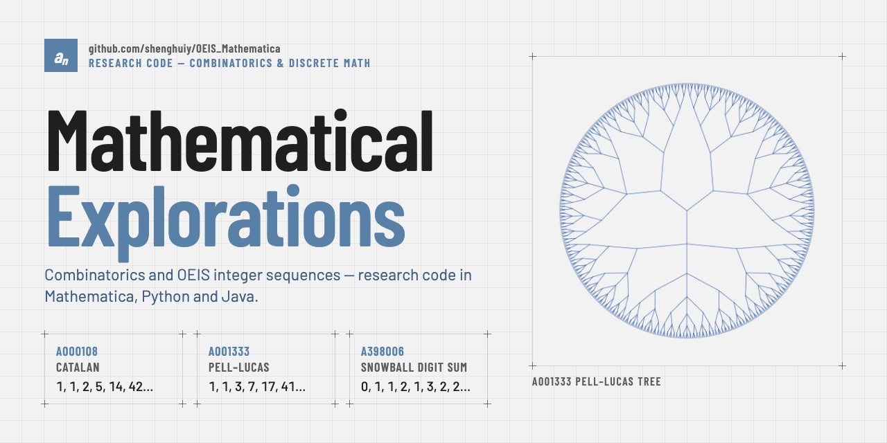

# Discrete Mathematical Explorations

A collection of research-grade tools for discrete mathematics and number theory: inverting arithmetic functions, sieving for exotic integer sequences, dissecting the dynamics of Bulgarian solitaire, solving the TopSpin permutation puzzle, and doing carry-less arithmetic. The code is written in Wolfram Language, Java and Python, checked against the literature, and explained page by page.

  <picture>
    <source media="(prefers-color-scheme: dark)" srcset="docs/img/banner-dark.png">
    
  </picture>

## Highlights

- **Inverting arithmetic functions.** [`DivisorSigmaInverse`](docs/DivisorSigmaInverse.md) lists every $x$ with $\sigma_k(x) = n$, and [`EulerPhiInverse`](docs/EulerPhiInverse.md) every $x$ with $\varphi(x) = n$. Both are compiled with `FunctionCompile`; `EulerPhiInverse` returns all 220,281 solutions for $n = 2^{20} \cdot 3^5 \cdot 5^2 \cdot 7$ in about 0.06 s.
- **Sieving for rare integers.** [A399539](docs/A399539.md) uses a compiled segmented sieve to find the numbers $k$ with $\psi(k) - \varphi(k) = d(k)^4$.
- **Bulgarian solitaire, end to end.** [One package](docs/BulgarianSolitaire.md) covers orbits, cycles and Brandt's necklace count, Garden of Eden partitions (OEIS [A123975](https://oeis.org/A123975)), game-tree level sizes and the row-to-column game. It reproduces the closed forms in Pham's work on limiting level-size series, and tests her conjecture on every primitive necklace of length 3 to 5.
- **Permutation puzzles.** [`TopSpinSolve`](docs/TopSpin.md) solves any position of the 20-token TopSpin puzzle in about 0.4 ms by sifting it through a stored table of short words, built once by a compiled run of Minkwitz's algorithm. Its solutions average about 180 moves, under a third of what the built-in `GroupElementToWord` gives.
- **Carry-less arithmetic.** [`CarrylessArithmetic`](docs/CarrylessArithmetic.md) ports David Applegate's dismal-arithmetic program to Java, matching the original C output line for line, searches divisors and ranges of numbers in parallel (Java parallel streams), and can be called from Mathematica through [J/Link](https://reference.wolfram.com/language/JLink/tutorial/Overview.html).
- **Tested.** Java and Python tests run in CI; the Wolfram packages have `VerificationTest` suites that include the examples from the docs.

## Documentation

Explanations of the code in this repository are in [`docs/`](docs/README.md).

### Functions

- [Carry-less (dismal) arithmetic in Java](docs/CarrylessArithmetic.md): `src/java/CarrylessArithmetic.java`, its methods, and how to call it from Java and from Mathematica via J/Link. See also the [Numberphile video](https://www.youtube.com/watch?v=cZkGeR9CWbk) on dismal arithmetic.
- [DivisorSigmaInverse](docs/DivisorSigmaInverse.md): `src/wolfram/DivisorSigmaInverse.wl`, a Mathematica port of `invsigmaDiv` from Max Alekseyev's `invphi.gp`; `invSigmaDivisors[n, k]` lists every $x$ with $\sigma_k(x)$ equal to each divisor of $n$, `DivisorSigmaInverse[n, k]` gives the solutions for $n$ itself, and `DivisorSigmaInverseCount[n, k]` counts them.
- [Bulgarian solitaire](docs/BulgarianSolitaire.md): `src/wolfram/BulgarianSolitaire.wl`, the solitaire move on partitions with orbits, cycles and their count, Garden of Eden partitions, game-tree level sizes, and the row-to-column game.
- [EulerPhiInverse](docs/EulerPhiInverse.md): `src/wolfram/EulerPhiInverse.wl`, a compiled depth-first search for every $x$ with $\varphi(x) = n$; `EulerPhiInverse[n]` returns them sorted.
- [TopSpin solver](docs/TopSpin.md): `src/wolfram/TopSpin.wl`, rotations and flips that solve any 20-token position, found by sifting it through a stored table of short words; `TopSpinSolve[state]` returns the moves and `TopSpinApply[state, moves]` replays them.

### Wolfram Function Repository

Functions published in the Wolfram Function Repository, linked directly since they have no pages in `docs/`:

- [FoataTransform](https://resources.wolframcloud.com/FunctionRepository/resources/FoataTransform/): Foata's fundamental transformation of a permutation.
- [InverseFoataTransform](https://resources.wolframcloud.com/FunctionRepository/resources/InverseFoataTransform/): the inverse of Foata's fundamental transformation.
- [FindFanoPlaneIsomorphism](https://resources.wolframcloud.com/FunctionRepository/resources/FindFanoPlaneIsomorphism/): finds an isomorphism between Fano planes.
- [ParkingFunctionQ](https://resources.wolframcloud.com/FunctionRepository/resources/ParkingFunctionQ/): tests whether a list is a parking function.
- [ParkingFunctionToDyckWords](https://resources.wolframcloud.com/FunctionRepository/resources/ParkingFunctionToDyckWords/): converts a parking function to Dyck words.
- [EulerianNumberTriangle](https://resources.wolframcloud.com/FunctionRepository/resources/EulerianNumberTriangle/): the triangle of Eulerian numbers.
- [DivisorHasseDiagram](https://resources.wolframcloud.com/FunctionRepository/resources/DivisorHasseDiagram/): the Hasse diagram of the divisors of an integer under divisibility.
- [PermutationExcedances](https://resources.wolframcloud.com/FunctionRepository/resources/PermutationExcedances/): the excedances of a permutation.
- [DistinctCompactBinaryHuffmanCode](https://resources.wolframcloud.com/FunctionRepository/resources/DistinctCompactBinaryHuffmanCode/): distinct compact binary Huffman codes.

### OEIS sequences

I have contributed to 38 OEIS entries (see my [edit history](https://oeis.org/history?user=Shenghui%20Yang)): [A003586](https://oeis.org/A003586), [A003785](https://oeis.org/A003785), [A028931](https://oeis.org/A028931), [A059204](https://oeis.org/A059204), [A062023](https://oeis.org/A062023), [A091960](https://oeis.org/A091960), [A101198](https://oeis.org/A101198), [A101200](https://oeis.org/A101200), [A123975](https://oeis.org/A123975), [A126859](https://oeis.org/A126859), [A126862](https://oeis.org/A126862), [A157196](https://oeis.org/A157196), [A262599](https://oeis.org/A262599), [A306934](https://oeis.org/A306934), [A344009](https://oeis.org/A344009), [A357702](https://oeis.org/A357702), [A378674](https://oeis.org/A378674), [A382454](https://oeis.org/A382454), [A383732](https://oeis.org/A383732), [A383976](https://oeis.org/A383976), [A384114](https://oeis.org/A384114), [A384490](https://oeis.org/A384490), [A384637](https://oeis.org/A384637), [A384677](https://oeis.org/A384677), [A391562](https://oeis.org/A391562), [A391954](https://oeis.org/A391954), [A392206](https://oeis.org/A392206), [A392208](https://oeis.org/A392208), [A392719](https://oeis.org/A392719), [A394309](https://oeis.org/A394309), [A397064](https://oeis.org/A397064), [A397210](https://oeis.org/A397210), [A397660](https://oeis.org/A397660), [A397794](https://oeis.org/A397794), [A397851](https://oeis.org/A397851), [A398006](https://oeis.org/A398006) and [A399539](https://oeis.org/A399539), [A401118](https://oeis.org/A401118). The ones with code here:

- [A316667](docs/A316667.md): `src/wolfram/A316667.wl`, the trapped knight walk on the square-spiral chessboard.
- [A399539](docs/A399539.md): `src/wolfram/A399539.wl`, a compiled segmented sieve for numbers $k$ with $\psi(k) - \varphi(k) = d(k)^4$, with timings and the checks run in Mathematica.
- [A157196](docs/A157196.md): `src/wolfram/A157196.wl`, a string construction for the self-describing sequence of 1s and 2s, with the checks run in Mathematica.
- [A003785](docs/A003785.md): `src/wolfram/A003785.wl`, a Mathematica translation of the OEIS PARI program built from eta-function products.
- [A101198](docs/A101198.md): `src/wolfram/A101198.wl`, the number of partitions of n with rank 1, and with any rank m (A047993, A101199, A101200, A363213, A363214), from Dyson's rank generating function as proved by Atkin and Swinnerton-Dyer.
- [A101199](docs/A101199.md), [A101200](docs/A101200.md), [A363213](docs/A363213.md) and [A363214](docs/A363214.md): the numbers of partitions of n with rank 2, 3, 4 and 5, computed by `PartitionRankCount` from the A101198 package, with the formula for each rank.
- [A064174](docs/A064174.md): `src/wolfram/A064174.wl`, the number of partitions of n with nonnegative rank, by Jovovic's sum of partition numbers and by a recurrence in the sequence itself, with its asymptotic. Not yet one of the contributed entries above: the recurrence and the asymptotic are not in the OEIS entry.
- [A401118](docs/A401118.md): `src/wolfram/A401118.wl`, the largest subset of $\lbrace 1..n\rbrace$ with no three numbers whose pairwise LCMs are equal ([Erdős problem #536](https://erdosproblemaday.com/problem/536)), by a compiled exhaustive search over subsets generated with `IncrementalFunction`; [A401118_SCIP](docs/A401118_SCIP.md) (`src/wolfram/A401118_SCIP.wl`) solves it as an integer linear program, with SCIP through `ForeignFunctionLoad` ([`src/c/a401118_scip`](src/c/a401118_scip)) or with `LinearOptimization`, and reaches all [656 b-file terms](https://oeis.org/A401118/b401118.txt).
- [A400000](docs/A400000.md): `src/wolfram/A400000.wl`, the city-building sequence, by a compiled backward scan that skips blocks of buildings below the line of sight, linear in practice where the program on the OEIS page is quadratic; `src/python/a400000.py` has the same method and a convex-hull variant in Python. Not one of the contributed entries above.
- [A123975](https://oeis.org/A123975): the number of Garden of Eden partitions of $n$ in Bulgarian solitaire, computed by [`BulgarianSolitaireGardenOfEdenCount`](src/wolfram/BulgarianSolitaire.wl#L129) from the Hopkins–Sellers formula $p(n-3) - p(n-9) + p(n-18) - \cdots$; see the [Bulgarian solitaire](docs/BulgarianSolitaire.md) page.

Tests for the Java code are described in [`test/java/README.md`](test/java/README.md), and tests for the Wolfram code in [`test/wolfram/README.md`](test/wolfram/README.md).

## License

[MIT](LICENSE)
